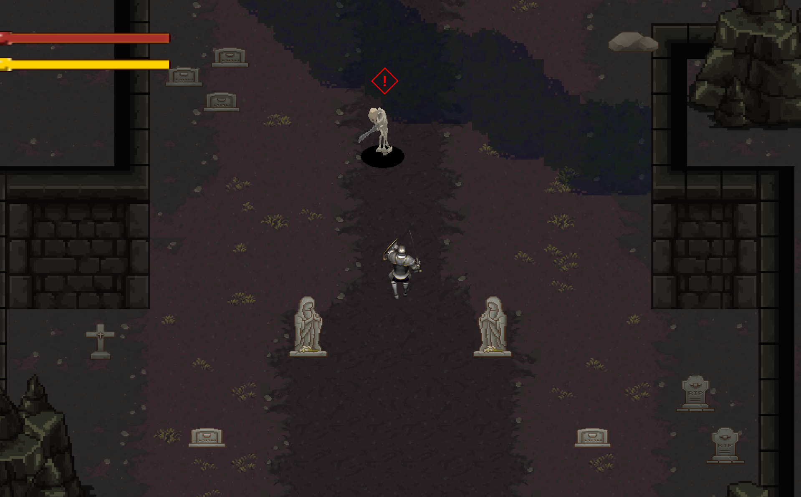
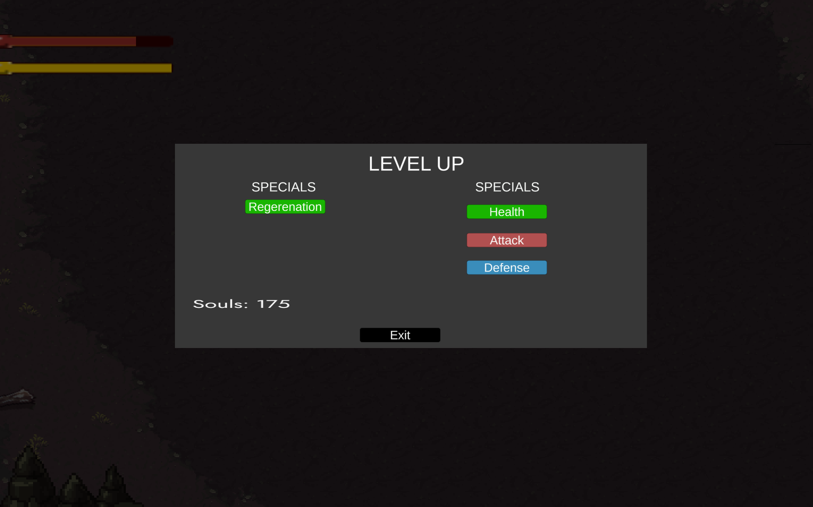
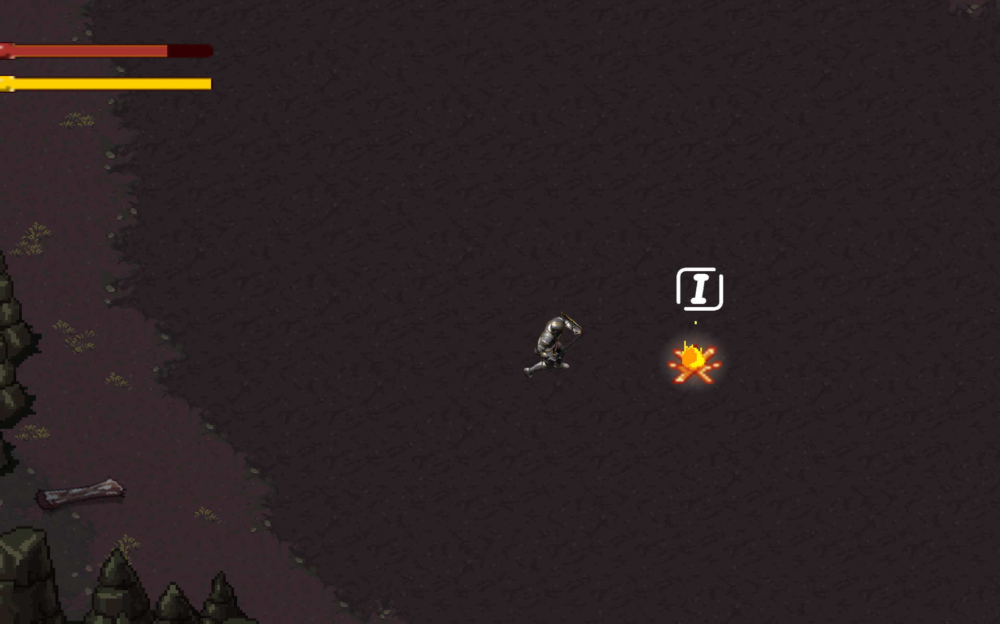

# Souls Game

A top-down 2D action RPG in Unity (2022.3.22f1) with Souls-like combat. **This was my first Unity project, made in high school.**

## What is in the game
- Top-down movement with WASD, a dash on Space, sword attacks on left mouse click, pause on Esc (controls as shown on the in-game title screen).
- Health and stamina bars, melee combat with three sword attacks, and enemies that show an alert marker (!).
- Player animations in eight directions: idle, walking, running, roll and the three attacks.
- A level-up screen where souls are spent on Regeneration, Health, Attack or Defense.
- Bonfires to interact with (the prompt shows the I key), as in the games that inspired it.

## How the characters were made
The player character was made from a 3D model that was rendered from a camera into 8-direction sprite sheets (the attack sheets are in `PlayerCharacter/Sprites` in the original project). *(The exact tools and steps are described by the author; this section will be filled in.)*

## What this repository contains
Only my own work from the project: the scripts, scenes, animations and small assets in `Assets/Scenes`, the project settings and the package list. It does **not** contain:
- the large 8-direction player sprite sheets (about 680 MB), and
- third-party asset packs that the original project used for tiles, effects and tools (for example a pathfinding package and several pixel-art packs). They have their own licences and are not redistributed here.

So opening this repository in Unity shows missing art; it is here to show the code and how the game was put together.
